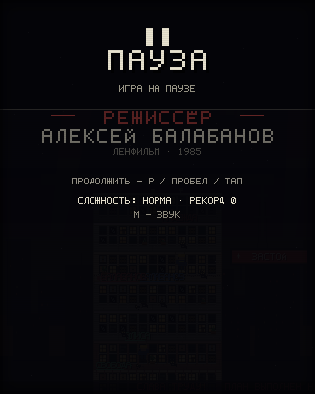
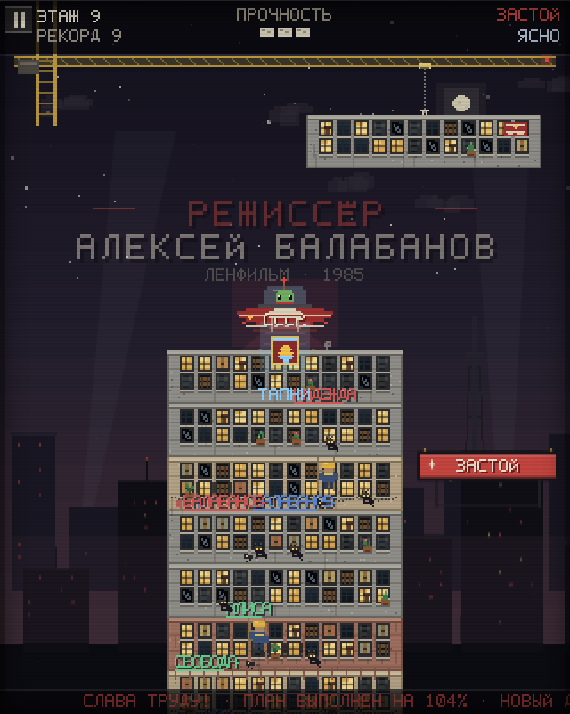
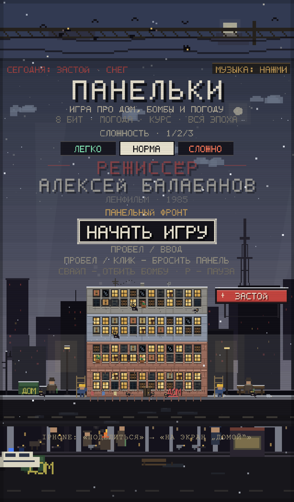

# ПАНЕЛЬКИ — tower blocks

Восьмибитная игра про строительство панельного дома в постсоветском дворе. Никаких внешних ассетов: вся графика, шрифт, музыка и звуки генерируются кодом.

## Живая версия

**https://alexserov.github.io/panelki/**

Сканировать с телефона:


## Запуск

Просто откройте `index.html` в браузере (Chrome / Firefox / Safari). Или:

```bash
python3 -m http.server 8080
# затем http://localhost:8080
```

Звук включается после первого клика/нажатия клавиши — этого требует браузерная политика автозапуска. Игра пытается запустить титульную музыку сразу; если браузер блокирует автозапуск, нажмите на «МУЗЫКА» в правом верхнем углу или просто начните игру — музыка заиграет с первого касания.

## Сложность

На титульном экране три режима (клавиши `1`/`2`/`3`, стрелки или тап по кнопке):

- **ЛЕГКО · ТИХИЙ ДВОР** — медленнее кран, реже бомбы, 4 единицы прочности, широкое окно идеальной кладки.
- **НОРМА · ПАНЕЛЬНЫЙ ФРОНТ** — базовый баланс, 3 единицы прочности.
- **СЛОЖНО · АВРАЛ** — быстрый кран, частые бомбы, 2 единицы прочности, точная кладка.

Рекорды хранятся отдельно для каждого режима.

## Пауза

- `P` / `Esc` — пауза и продолжение.
- На телефоне — тап по кнопке `II` в левом верхнем углу HUD; продолжить можно тапом в любом месте.
- При сворачивании вкладки/приложения игра ставится на паузу автоматически.
- На паузе останавливаются таймеры, бомбы, погода и музыка.

## PWA / установка на телефон

Игра работает как PWA:

- на **Android/Chrome** появится кнопка «УСТАНОВИТЬ ИГРУ» (или меню → «Установить приложение»);
- на **iPhone** откройте сайт в Safari → «Поделиться» → «На экран „Домой“»;
- после первого запуска service worker кэширует игру, и она открывается офлайн;
- в установленном виде запускается без адресной строки, в портретной ориентации;
- на телефоне canvas растянут на всю ширину экрана, учтены safe-area (вырез/жесты), а фон заполнен атмосферным размытым кадром.

Для PWA нужен HTTPS (GitHub Pages даёт его автоматически) или `localhost`.

## Скриншоты

| | |
|---|---|
|  |  |
|  |  |
|  |  |
|  |  |

Ещё: [офлайн-режим](screenshots/offline.png), [начало стройки](screenshots/start.png).

## Управление

| Действие | Клавиатура | Мышь / тач |
|---|---|---|
| Бросить панель | `Пробел` / `Enter` | клик / тап |
| Отбить бомбу влево/вправо | `←` / `→` (или `A`/`D`) | свайп влево/вправо |
| Пауза | `P` / `Esc` | кнопка `II` в HUD / тап по паузе |
| Сложность в меню | `1` / `2` / `3`, `←` / `→` | тап по «ЛЕГКО / НОРМА / СЛОЖНО» |
| Собрать бонус | — | тап по звезде под парашютом |
| Звук вкл/выкл | `M` | кнопка «МУЗЫКА» в меню |

## Что происходит в игре

- **Панельки.** Дом собирается из панелей: серые, бежевые, кирпичные, зелёные и голубые варианты. У каждой панели своя сетка окон, балконы, подъезд, антенны, тарелки, бельё на верёвке.
- **Окна.** Светятся, темнеют, покрываются грязью, трескаются, забиваются досками. Гроза и смена курса могут разбить стекло.
- **Граффити.** Со временем на стенах появляются теги: «ЦОЙ», «КИНО», «АЛИСА», «1984», «БАЛАБАНОВ», «СВОБОДА» и другие.
- **Растения.** На подоконниках и балконах время от времени растут фикусы, алоэ и герани.
- **Жильцы двора.** Коты сидят на подоконниках и крышах, бомжи греются у мусорки и на скамейке, крысы бегают по улице и крышам, инженеры-электрики чинят проводку (могут восстановить прочность дома).
- **Бомбы.** Падает бомба — её нужно свайпнуть влево или вправо. Если не отбить, она сносит верхний этаж и уменьшает прочность. Три потери прочности — конец стройки.
- **Инопланетяне-коммунисты.** Время от времени над домом пролетает красный НЛО с надписью «СССР», зелёным товарищем в куполе и лучом. Он сбрасывает на крышу бонус — успейте тапнуть по звезде.
- **Бонусы.** «Ремонт» (+1 прочность), «Щит» (принимает следующую бомбу или промах), «Заморозка» (кран медленнее 15 секунд), «Магнит» (следующие 2 панели лягут идеально). Активные бонусы видны строкой над бегущей новостью.
- **Сложность.** Три режима в главном меню; у каждого свои скорость крана, частота бомб, запас прочности, допуск идеальной кладки и отдельный рекорд.
- **Пауза.** `P`/`Esc`, кнопка `II` в HUD или тап; при сворачивании приложение ставится на паузу само. На паузе замирают таймеры, бомбы, погода и музыка.
- **Погода.** Ясно, пасмурно, дождь, снег, туман, гроза. Меняются небо, осадки, лужи, видимость; в грозу бьёт молния, а ветер ускоряет движение панели.
- **Политический режим.** Застой, оттепель, перестройка, лихие 90-е, стабильность, гласность, анархия. Меняются небо, плакат на крыше, лозунги, новости в бегущей строке, частота бомб и музыка.
- **Режиссёр.** На фоне всегда висит титр «РЕЖИССЁР АЛЕКСЕЙ БАЛАБАНОВ» (и на титульном экране, и в игре, и на экране проигрыша).
- **Музыка.** Четырёхканальный 8-битный секвенсор: у каждого режима свой лад, тональность, темп, прогрессия и мелодия; погода меняет темп и перкуссию (дождь — шум, снег — колокольчики, туман — низкий дрон, гроза — раскаты). При низкой прочности и летящей бомбе музыка становится напряжённее.

## Технически

- Внутреннее разрешение 320×400, масштабирование `image-rendering: pixelated`; на телефоне canvas растягивается на всю ширину (`fit()` + safe-area).
- Собственный растровый шрифт 5×7 с кириллицей.
- Canvas 2D, процедурная графика, `requestAnimationFrame`.
- WebAudio: секвенсор с lookahead-планированием, квадратные/треугольные волны, шумовая перкуссия, эмбиент дождя/ветра, SFX. При паузе AudioContext приостанавливается.
- Прогресс (рекорд для каждого режима сложности) хранится в `localStorage`.

## Проверено

- Запуск в Chrome через `file://` и на GitHub Pages, без ошибок в консоли.
- Свайп мышью/тачем вправо: бомба получает `vx = +320` и флаг `deflected` (также проверены стрелки).
- Клик/тап бросает панель; дом растёт, камера поднимается, улица уезжает вниз.
- Запуск на «ЛЕГКО»: 4 единицы прочности, отдельный рекорд сохраняется в `panelki.best.easy`.
- Пауза (`P` и кнопка `II`): `paused=true`, AudioContext → `suspended`; продолжение возвращает `running` и музыку.
- Смена погоды и режима: небо, плакат, HUD, бегущая строка и музыка меняются.
- Музыкальный движок реально играет: ступень секвенсора и счётчик нот растут; для «Застоя» — 84 BPM, натуральный минор, для «Лихих 90-х» + гроза — 144.9 BPM, фригийский лад, для «Анархии» + туман — 152 BPM, целотонный лад.
- НЛО: фаза `drop`, луч включён, бонус появляется на крыше и собирается тапом; проверены «Ремонт» (1→2 прочности), «Щит» (поглощает бомбу без потери этажа), «Магнит» (2 идеальные панели, ширина сохраняется).
- На экране проигрыша выводится статистика дома: коты, фикусы, алоэ, герани, крысы, бомжи, электрики, граффити, разбитые окна, отбитые бомбы, бонусы, НЛО, смены курса и погоды.
- PWA: `manifest.webmanifest` без ошибок, service worker активирован, кэш `panelki-v5-shell` (15 файлов), после отключения сети страница перезагружается и запускается офлайн; иконки 192/512/maskable отдаются с HTTPS-сервера; установка доступна без ошибок (`getInstallabilityErrors` пуст).
- Мобильный профиль iPhone 13: canvas 390×487, `x=0`, padding stage `0px` — edge-to-edge по ширине, safe-area и iOS-подсказка установки.
