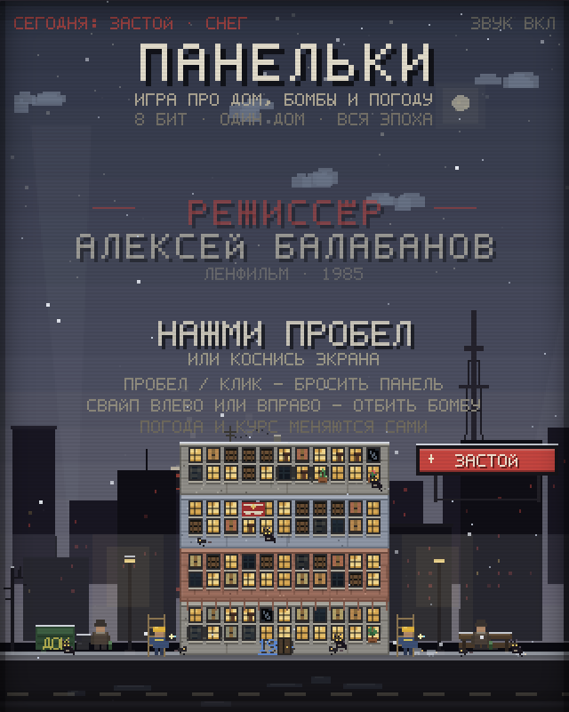
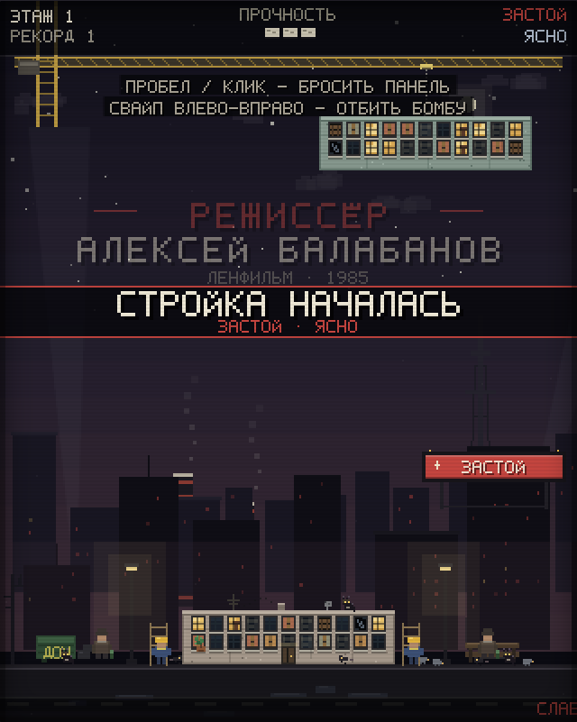
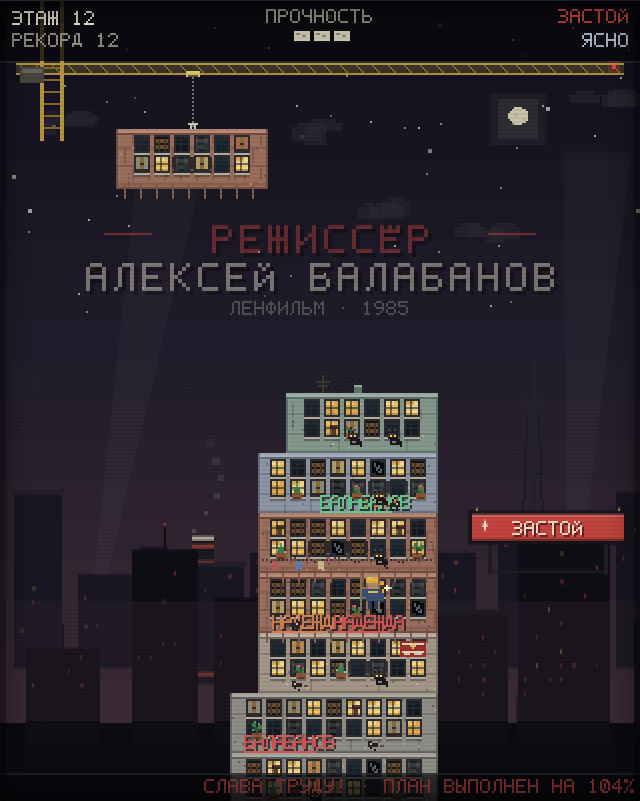
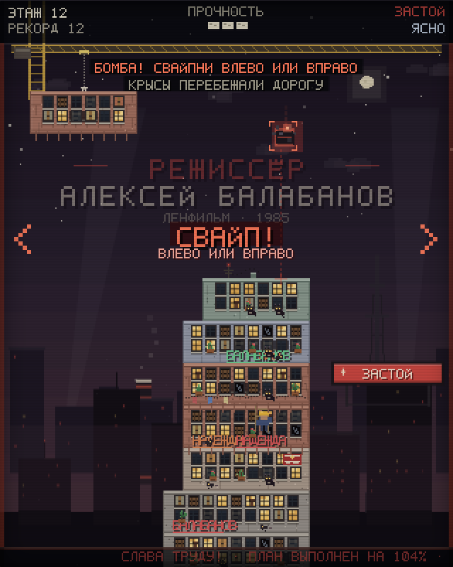
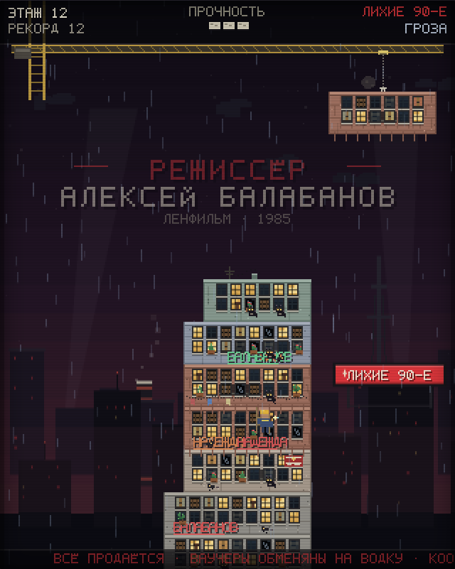
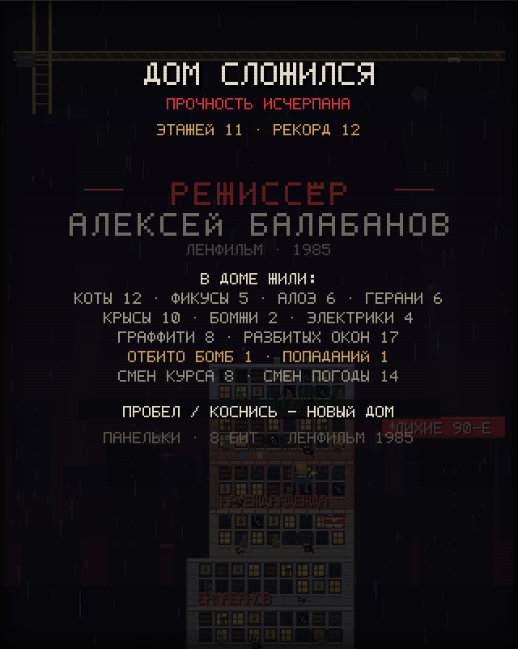

# ПАНЕЛЬКИ — tower blocks

Восьмибитная игра про строительство панельного дома в постсоветском дворе. Никаких внешних ассетов: вся графика, шрифт, музыка и звуки генерируются кодом.

## Запуск

Просто откройте `index.html` в браузере (Chrome / Firefox / Safari). Или:

```bash
python3 -m http.server 8080
# затем http://localhost:8080
```

Звук включается после первого клика/нажатия клавиши — этого требует браузерная политика автозапуска.

## Скриншоты

| | |
|---|---|
|  |  |
|  |  |
|  |  |

## Управление

| Действие | Клавиатура | Мышь / тач |
|---|---|---|
| Бросить панель | `Пробел` / `Enter` | клик / тап |
| Отбить бомбу влево/вправо | `←` / `→` (или `A`/`D`) | свайп влево/вправо |
| Звук вкл/выкл | `M` | — |

## Что происходит в игре

- **Панельки.** Дом собирается из панелей: серые, бежевые, кирпичные, зелёные и голубые варианты. У каждой панели своя сетка окон, балконы, подъезд, антенны, тарелки, бельё на верёвке.
- **Окна.** Светятся, темнеют, покрываются грязью, трескаются, забиваются досками. Гроза и смена курса могут разбить стекло.
- **Граффити.** Со временем на стенах появляются теги: «ЦОЙ», «КИНО», «АЛИСА», «1984», «БАЛАБАНОВ», «СВОБОДА» и другие.
- **Растения.** На подоконниках и балконах время от времени растут фикусы, алоэ и герани.
- **Жильцы двора.** Коты сидят на подоконниках и крышах, бомжи греются у мусорки и на скамейке, крысы бегают по улице и крышам, инженеры-электрики чинят проводку (могут восстановить прочность дома).
- **Бомбы.** Падает бомба — её нужно свайпнуть влево или вправо. Если не отбить, она сносит верхний этаж и уменьшает прочность. Три попадания / промаха — конец стройки.
- **Погода.** Ясно, пасмурно, дождь, снег, туман, гроза. Меняются небо, осадки, лужи, видимость; в грозу бьёт молния, а ветер ускоряет движение панели.
- **Политический режим.** Застой, оттепель, перестройка, лихие 90-е, стабильность, гласность, анархия. Меняются небо, плакат на крыше, лозунги, новости в бегущей строке, частота бомб и музыка.
- **Режиссёр.** На фоне всегда висит титр «РЕЖИССЁР АЛЕКСЕЙ БАЛАБАНОВ» (и на титульном экране, и в игре, и на экране проигрыша).
- **Музыка.** Четырёхканальный 8-битный секвенсор: у каждого режима свой лад, тональность, темп, прогрессия и мелодия; погода меняет темп и перкуссию (дождь — шум, снег — колокольчики, туман — низкий дрон, гроза — раскаты). При низкой прочности и летящей бомбе музыка становится напряжённее.

## Технически

- Внутреннее разрешение 320×400, масштабирование `image-rendering: pixelated`.
- Собственный растровый шрифт 5×7 с кириллицей.
- Canvas 2D, процедурная графика, `requestAnimationFrame`.
- WebAudio: секвенсор с lookahead-планированием, квадратные/треугольные волны, шумовая перкуссия, эмбиент дождя/ветра, SFX.
- Прогресс (лучший результат) хранится в `localStorage`.

## Проверено

- Запуск в Chrome через `file://`, без ошибок в консоли.
- Свайп мышью вправо: бомба получает `vx = +320` и флаг `deflected` (также проверены стрелки).
- Клик/тап бросает панель; дом растёт, камера поднимается, улица уезжает вниз.
- Смена погоды и режима: небо, плакат, HUD, бегущая строка и музыка меняются.
- Музыкальный движок реально играет: ступень секвенсора и счётчик нот растут; для «Застоя» — 84 BPM, натуральный минор, для «Лихих 90-х» + гроза — 144.9 BPM, фригийский лад, для «Анархии» + туман — 152 BPM, целотонный лад.
- На экране проигрыша выводится статистика дома: коты, фикусы, алоэ, герани, крысы, бомжи, электрики, граффити, разбитые окна, отбитые бомбы, смены курса и погоды.
